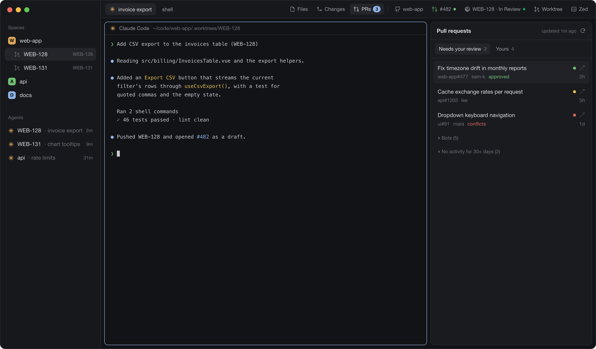
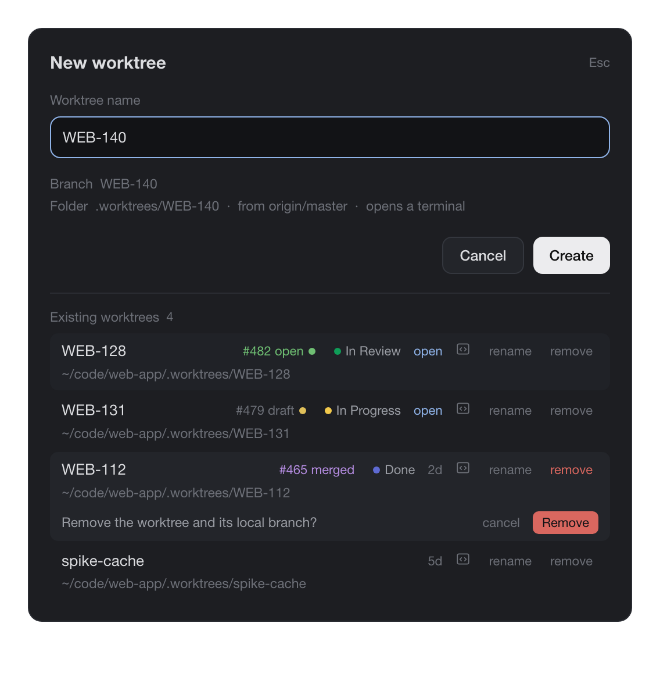
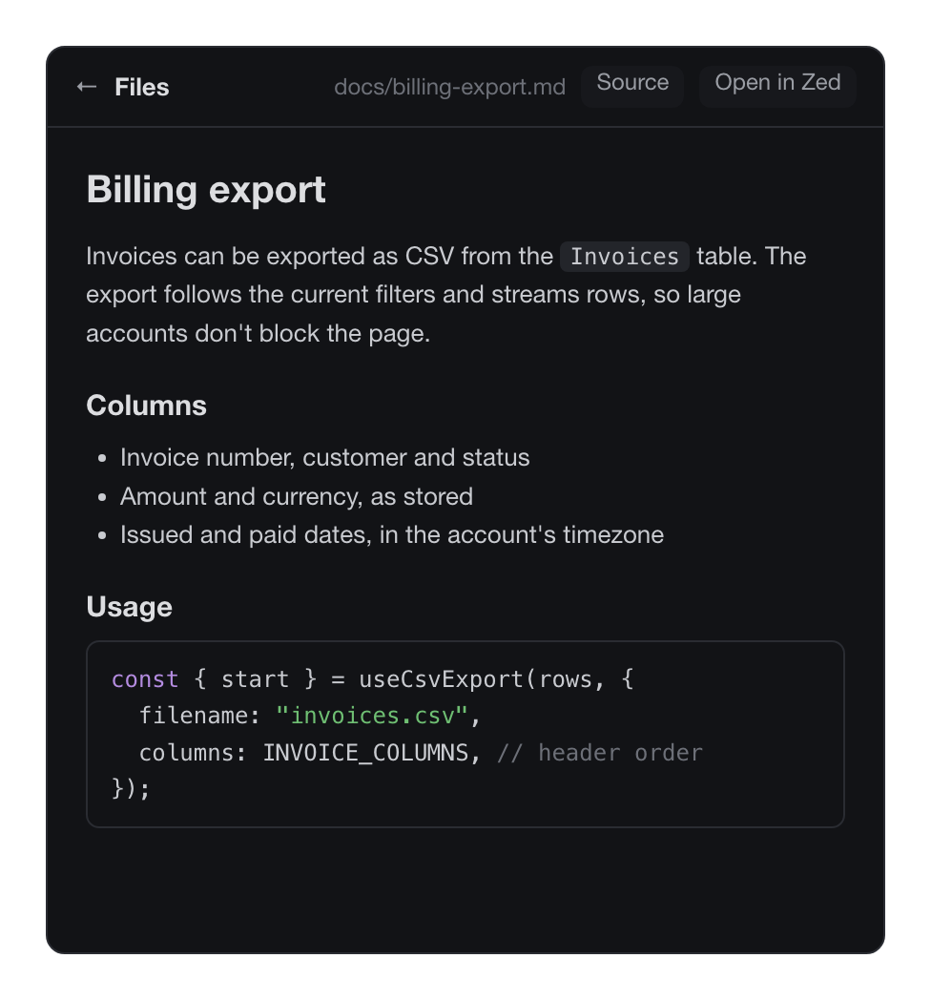

# herdr-mods

[](https://github.com/neelrocketbots/herdr-mods/actions/workflows/ci.yml)

Mods and a layout for the [Herdr](https://herdr.dev) desktop app, built around
one git worktree per Linear issue: GitHub, PR, CI and Linear links for the
focused terminal, a worktree dialog, a PR inbox, markdown previews, and "open in
your editor" everywhere.



These are **desktop app mods** (`~/.config/herdr-app`), not herdr TUI plugins.
All images are mockups with made-up data.

## Units

Each folder is one installable unit in Herdr's sharing format (`mods/<name>/`,
`RECIPE.md`, `preview.png`, sometimes `keys.json` or `layouts/`), with a README
and a screenshot. Take one or all.

| Unit | What it is |
| --- | --- |
| [`quick-links`](quick-links) | Top bar: GitHub repo, the branch's PR with a CI dot, open PRs in other repos that name the branch's Linear issue, the Linear issue, your editor. Adds **PRs**, **Worktree** and **Merged · clean up** when `pr-inbox` / `issue-worktree` are installed |
| [`issue-worktree`](issue-worktree) | Dialog (⌘⌥N): make `<repo>/.worktrees/<name>` on branch `<name>` from a fresh `origin/master`; list worktrees with PR and CI; rename, remove, open in your editor |
| [`pr-inbox`](pr-inbox) | PRs waiting on your review and your own, across repos. A side panel in `custom-herdr`, a dialog (⌘⌥P) anywhere else |
| [`files-md`](files-md) | Herdr's Files panel, plus rendered markdown (images included) and open in your editor |
| [`changes-editor`](changes-editor) | Herdr's Changes panel, plus open in your editor |
| [`custom-herdr`](custom-herdr) | Layout: Herdr's main layout with all of the above wired in (bundles its own copies of the mods) |

<p>
  
  
</p>

## Install

Ask the agent in your Herdr window: *Read ~/.config/herdr-app/AGENTS.md, then add
this mod: &lt;the unit's folder on GitHub&gt;*. Or from a clone:

```sh
git clone https://github.com/neelrocketbots/herdr-mods.git
cd herdr-mods
sh install.sh --switch             # everything, then switch to the custom-herdr layout
sh install.sh pr-inbox files-md    # or just some units
```

`install.sh` copies each unit's mods (and layout) into the app folder
(`$HERDR_APP_HOME`, else `~/.config/herdr-app`) and runs `herdr-app check` on
them. Layout files that differ are backed up first. A unit's `keys.json` is merged
into yours without replacing keys you already use. Your settings file,
`herdr-mods.json`, is created from `herdr-mods.example.json` once and never
overwritten.

Requires `git`, `jq`, and `gh` signed in (`gh auth status`).

## Settings: `~/.config/herdr-app/herdr-mods.json`

```json
{
  "editor": "zed",
  "linear": {
    "your-github-org": "your-linear-workspace"
  }
}
```

- `editor`: what the editor buttons open. One of `zed`, `cursor`, `vscode`,
  `windsurf`, `sublime`, `webstorm`, `idea`, `nova` (its CLI, else its macOS
  app); a macOS app, `{ "name": "BBEdit", "app": "BBEdit" }`; or a command,
  `{ "name": "Helix", "command": ["wezterm", "start", "--", "hx", "{path}"] }`.
  Buttons are labelled with its name.
- `linear`: maps a GitHub owner (the `org` in `github.com/org/repo`) to its
  Linear workspace slug (the part after `linear.app/`); `"*"` maps every repo.
  Linear links, and the lookup of PRs in other repos that name the branch's
  issue, only appear for mapped owners.

Changes apply within a few seconds. Other knobs are constants at the top of each
`main.js` (see each unit's RECIPE.md).

## Linear issue status (optional)

With a Linear API key, the top bar's Linear button reads `WEB-140 · In Review`
with the status's color, and each worktree row shows its issue's status.

1. In Linear, **Settings → Account → Security & access → Personal API keys →
   New key**, with read access only.
2. Put it in your macOS Keychain (this prompts for it, so it stays out of your
   shell history):

   ```sh
   security add-generic-password -a "$USER" -s herdr-mods-linear -w
   ```

The mods read the key in a shell on each request and hand it to `curl` on stdin,
so it's never in a file, a command line or the mod. `$LINEAR_API_KEY` works too,
if the app's environment has it. To remove it:
`security delete-generic-password -s herdr-mods-linear`, then revoke it in Linear.

## What these mods run

They're trusted code, like any Herdr mod, and run as you:

| Mod | Programs | Network | Files outside its folder |
| --- | --- | --- | --- |
| quick-links | `git` (remote, branch, rev-parse), `gh pr view`, `gh search prs`, your editor, `open`; with a Linear key: `security`, `curl` | GitHub, through `gh`; Linear's API | reads `herdr-mods.json` and other mods' `mod.json`; reads the Linear key from the Keychain |
| issue-worktree | `git` (fetch, worktree add/move/remove, branch -m/-D, status), `gh api graphql`, your editor; with a Linear key: `security`, `curl` | GitHub (`gh`), your git remote (`git fetch`), Linear's API | appends `.worktrees/` to the repo's `.git/info/exclude` when it isn't ignored; reads `herdr-mods.json`; reads the Linear key from the Keychain |
| pr-inbox | `gh api graphql`, `open` | GitHub, through `gh` | none |
| files-md | Herdr's own (`git`, file reads), your editor, `cp`/`curl`/`sips` for markdown images | remote images in markdown files (`curl`) | reads `herdr-mods.json`; caches images in `data/files-md/img` |
| changes-editor | Herdr's own (`git`, file reads) plus your editor | none added | reads `herdr-mods.json` |

Nothing is sent anywhere else. `gh` uses its own login; the Linear key, if you
add one, stays in your Keychain.
Removing a worktree runs `git branch -D` (after a confirm that warns about
uncommitted changes).

## How it stays fast

- quick-links keeps its lookups in localStorage, so links show at once after a
  restart and refresh behind. A PR is looked up again after 30 s while its CI
  runs, 60 s while open, 10 min once merged or closed.
- The worktree dialog fetches every worktree's PR in one GitHub request and
  remembers it between opens for a minute.
- The PR inbox refreshes every 3 minutes while shown, every 10 while hidden, and
  keeps its last result on disk. Shared values are written only when they change
  (every write re-renders every mod).

## Editing

The app hot-reloads `~/.config/herdr-app/mods`, so edit there, then:

```sh
sh scripts/pull.sh    # app -> units, units -> custom-herdr bundle; prints git status
sh scripts/check.sh   # what CI runs: scripts parse, JSON valid, copies identical, recipes present
```

`editor.js` (4 copies), `ci.js` and `linear.js` (2 copies each) must stay identical: mods can't
import from each other's folders. Regenerate the images with
`sh docs/mockups/render.sh` (headless Chrome): each unit's `screenshot.png` and
`preview.png`.

## License

Apache-2.0. `files-md` and `changes-editor` are modified copies of mods shipped
with Herdr (Apache-2.0); see [NOTICE](NOTICE).
