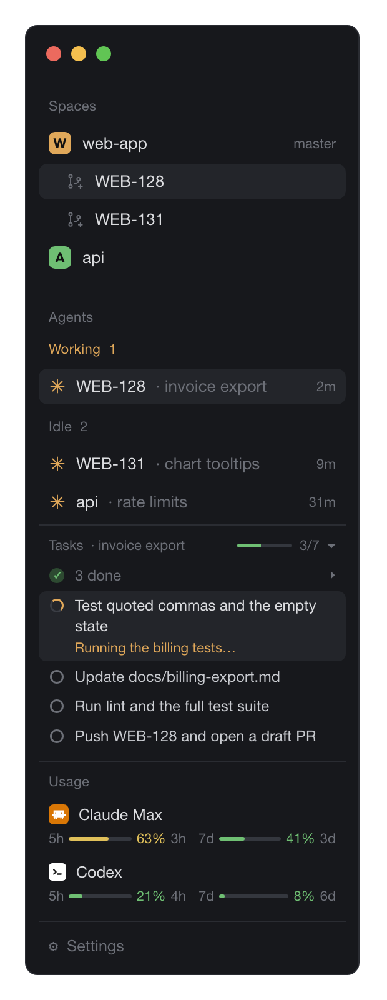

# agent-tasks

The task list of the Claude Code session working in the space you're in, live,
in the sidebar above Usage: what's done, what it's doing now, what's next. It
reads the list Claude Code already keeps, so there's nothing to set up.



## What it does

- **Which session**: the Claude Code running in one of the shown space's
  terminals (matched by its process, so it's always the space's own, whatever
  folder the space starts in). Several in one space: the most recently active
  one with a task list. Claude config folders other than `~/.claude` (like
  `~/.claude2` via `CLAUDE_CONFIG_DIR`) work too.
- **The list**: done tasks fold into "✓ 3 done" (click to see them); the task
  in progress is highlighted with a spinner and what the agent says it's doing
  ("Running the billing tests…"); next tasks one line each. Long lists scroll after about six rows.
- **Header**: "Tasks · <the agent's title>", a progress bar and `done/total`.
  Click it to fold the block to just that line (remembered).
- **Ended**: the space's last session with a task list, once it's no longer
  running, if it changed in the last day: its last list, faded, "ended 2h ago".
- **Subagents**: a row per subagent with a task list (its description, its
  count, and what it's doing while it works), up to four, newest first.
  Today's Claude Code doesn't give subagents the task tools, so these show
  only once it does.
- **Nothing to show**: the block keeps one line, "Tasks · no task list yet" (or
  "no Claude here"), so it doesn't pop in and out.
- **Smooth**: the list's height animates as rows come and go, and placeholder
  rows pulse while a space's list loads.
- **Details**: click a task (or a subagent) to open a box under it with its
  status, what it's doing, and its description; click again to close.
- **Live, by events**: it watches the session's transcript folder, so a change
  shows as Claude writes it (at most about two reads a second), and it
  switches with the space at once. It also checks every 30 seconds, and does
  nothing while the Herdr window is minimized, hidden or covered.

**Turn on Claude Code's task list.** Recent Claude Code versions ship it off.
Add both to the `env` of your Claude settings (`~/.claude/settings.json`, and
any other config folder you use):

```json
"env": { "CLAUDE_CODE_ENABLE_TASKS": "1", "CLAUDE_CODE_ENABLE_TODO_TOOLS": "1" }
```

Claude then uses it for multi-step work, or when you ask it to track steps.

## Install

```sh
sh install.sh agent-tasks
```

Or ask your Herdr agent to add this folder. Then add a block to your layout's
sidebar column, above Usage (`custom-herdr` has it):

```json
{ "id": "tasks", "type": "block", "size": { "px": 0 },
  "content": { "mod": "agent-tasks", "props": { "block": "tasks" } } }
```

It sizes the block to its content (one line when there's nothing to show).
Don't add it hidden: Herdr starts a block's mod only once it shows.

## What it runs

`hc get` for the process in each of the space's Claude terminals, then that
session's small JSON file in `~/.claude*/sessions`; `stat`, `tail`, `head`,
`od` and `grep` to read the new end of its transcript in
`~/.claude*/projects`; `sh` to list the `~/.claude*` folders. No network. It
never writes anything under `~/.claude*`.

## Limits

- Claude Code only (Codex plans aren't read).
- One session per space.
- An ended session is remembered only once the block has seen it running.
- Only Claude Code terminals Herdr recognizes as agents.
- Read-only: you can't tick tasks here.

How it's built: [RECIPE.md](RECIPE.md). Part of [herdr-mods](../README.md).
