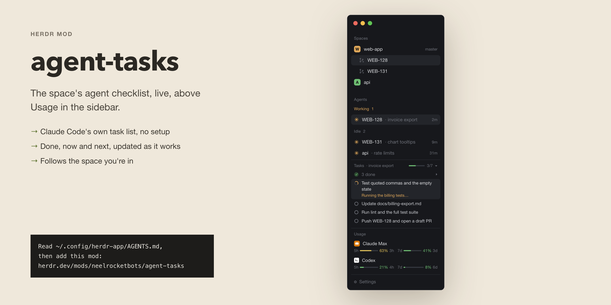

# Agent tasks

A sidebar block showing the task list (TaskCreate / TaskUpdate) of the Claude
Code session working in the shown space: done, now, next. Read-only, live.

## What you see

- A block on `chrome` with a 1px `border` line on top, 10px side padding,
  above the usage-limits block.
- Header, 11px `dim` (`foreground` on hover): "Tasks", "· <label>" truncated,
  a 44×3px bar on `input` filled in `ansi2` to done/total, `done/total`, and
  ▾/▸. Clicking it folds the block to the header; kept in localStorage
  (`agent-tasks.collapsed`).
- Rows, 12px, 8px gaps, a 13px mark column:
  - "✓ N done" in `dim` with ▸/▾: click to list the done tasks (✓ in `ansi2`,
    subject in `dim`, one line).
  - In progress: `raised` background, 6px corners, the spinner (`working`,
    else `ansi3`) turning, the subject in `foreground` wrapping, then its
    `activeForm` + "…" in 11px `working`.
  - Pending: an 11px ring in `dim`, subject in `muted`, one line.
  - Tooltip on every task: subject, a blank line, description.
- The rows scroll past 168px (about six).
- Ended session: label "· <its label> · ended 2h ago", rows at 0.6 opacity,
  no spinner turning, no activeForm.
- Label: the Herdr agent's title (`agents()` `title`), else the session's
  `name`. Ended: the label it had when last seen running.

## How it behaves

- Every 2s while `window()?.visible` isn't false, and at once when `render`
  sees a new active space; one read at a time (a stored `Task`, checked with
  `is_done()`; a tick during a read runs right after it). A result for a
  space that's no longer active is dropped. It redraws only when the label,
  the tasks or the "ended" minute changed.
- The space: the active one in `spaces()`; another machine's: nothing.
  `SpaceInfo.folder` is where new terminals start, not where the agent runs,
  so it isn't used.
- Its sessions: `agents()` in that space with `app` `"claude-code"`, highest
  `seq` first. For each, `hc get <address> --json` gives `foreground.pid`,
  the Claude process; `<config>/sessions/<pid>.json` gives `sessionId` and
  `cwd`, trying each config folder (`~/.claude`, `~/.claude?*`, listed every
  minute). The first with a task list wins, and is remembered for the space
  in localStorage (`agent-tasks.last`: transcript path and label).
- None: the remembered one, unless it's one of the live ones, if its
  transcript changed in the last 24h (checked with `stat` before reading).
- Transcript: `<config>/projects/<cwd, every non-alphanumeric char → "-">/<sessionId>.jsonl`.
- Reading it (`CHUNK` in `tasks.js`): `stat -f "%z %m"`; when it grew, only
  bytes `[offset, size)` via `tail -c +N | head -c M`, then `LC_ALL=C grep -E`
  for task calls and results and `grep -v '"type":"api-request'` (copies of
  whole API requests, up to ~150KB, that `feed` would ignore anyway; dropping
  them keeps the output small). If byte `size-1` isn't a newline the read
  would end mid-line: it exits 3 and the offset stays, so no line is lost.
  `LC_ALL=C` makes a 129MB file take ~1.5s instead of ~10s. A failed or
  timed-out read waits 30s before trying that file again. A file smaller than
  the offset starts over from 0. Offsets and replay state live in module
  scope per transcript.
- Replay (`tasks.js`, pure, tested with `node --test`): an `assistant` line's
  `tool_use` `TaskCreate` waits for the `user` line's `tool_result` with the
  same `tool_use_id`, whose `toolUseResult.task.id` is the task id; its
  `activeForm` comes from the call. `TaskUpdate` (`taskId`, `status`,
  `subject`, `description`, `activeForm`) merges; `deleted` drops it; an
  update before its create's result waits. `isSidechain` lines (subagents)
  and unparseable lines are skipped.
- Block: the layout block (`props.block`) starts at `"size": { "px": 0 }`,
  never hidden (a hidden block never starts its mod). `layout.resize` sizes it
  to the content's height, and to 0 when there's nothing to show. Without
  `props.block` it leaves the layout alone.

## Watch out

- Saving a mod file reloads it in place: its timers and tasks stop, instance
  state stays. The read is a stored Task, so a killed one doesn't block the
  next tick.
- Use the `cx` that `cx.spawn` / `cx.timer` hand in; a click's or render's
  `cx` throws on `notify()` once that call returned.
- `init` is `init(props, cx)`: `herdr-app check` doesn't catch `init(cx)`,
  since `checking()` returns before `cx` is used.
- The transcript format is Claude Code's, undocumented; checked on 2.1.329 to
  2.1.332.
