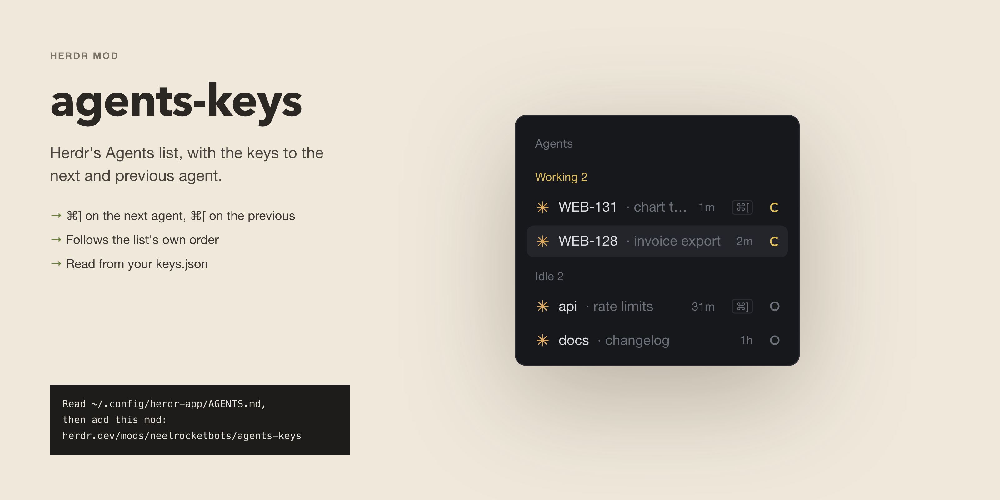

# Agents with keys

Herdr's Agents list with the next / previous agent keys shown on the rows they
reach.

## What you see

- Herdr's Agents list, unchanged, plus a key label on up to two full-width rows,
  between the time and the status icon: 14px tall, 3px side padding, 3px
  corners, a 1px `border` outline, 9.5px `dim` text.
  - The row `agent.next` goes to, from the focused agent: its key (`⌘]`).
  - The row `agent.prev` goes to: its key (`⌘[`).
  - With two agents both keys reach the same row: it shows `agent.next`'s.
- No focused agent, or only one: no labels. The collapsed rail is unchanged.

## How it behaves

- The list calls `setAgentOrder` with the order it shows (pinned first, then
  grouped or by priority), and `agent.next` / `agent.prev` follow it, wrapping.
  The labels use the same list: the focused agent's index ± 1, wrapping.
- Keys come from `keys()` once per render (first global binding per action),
  formatted like Herdr's own hints (⌘ ⌃ ⌥ ⇧ on macOS).

## Built from

- `herdr-app do mod.clone '{"name":"agents","as":"agents-keys"}'`, then in
  `main.js`: import `keys`; add `keyLabel`, `keyMap` and `kbd` helpers after the
  imports; after `setAgentOrder(...)` in `render()`, find the focused agent's
  index and map the previous and next addresses to their keys; in the full row,
  add `kbd(...)` after the time when the row's address has one.
- The layout's agents block: `{ "mod": "agents-keys" }`.

## Watch out

- Herdr replaces its shipped mods at start; edit only the clone.
- Sub-agent rows don't get labels: `agent.next` moves between the list's rows.

## Done when

- Switching agents moves the `⌘]` / `⌘[` labels to the rows those keys reach.
