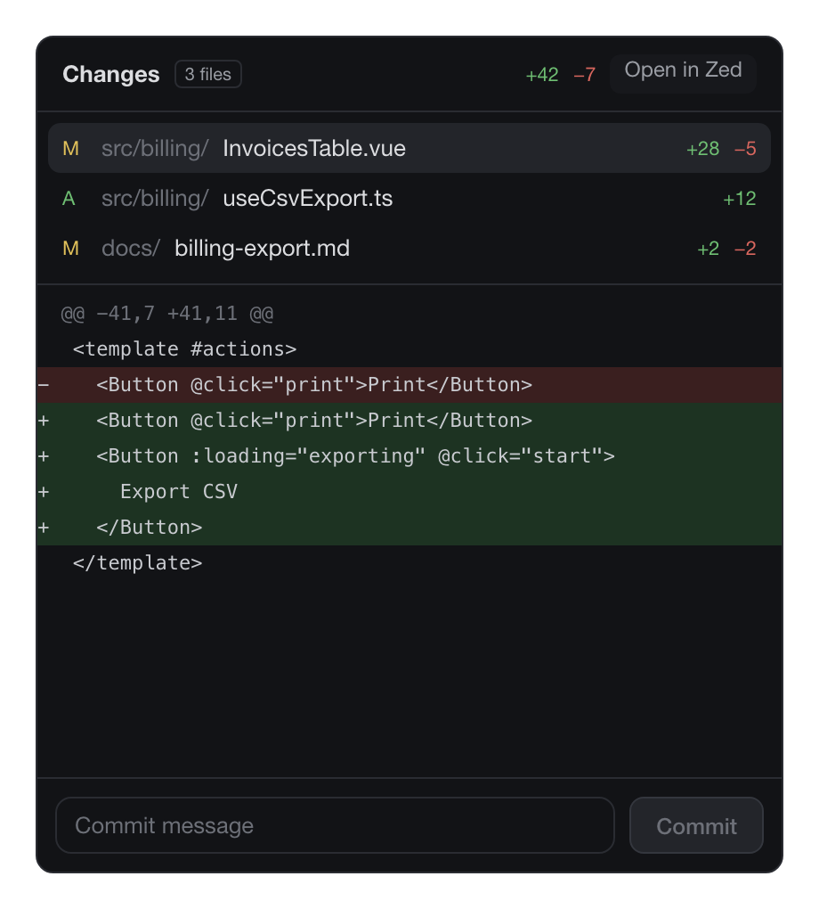

# changes-editor

Herdr's Changes panel with an **Open in &lt;editor&gt;** button for the selected
changed file.



## What it adds

- **Open in &lt;editor&gt;** next to the `+42 −7` totals, for the selected file.
  Hidden for deleted files and repos on other machines.
- Everything else is Herdr's Changes panel as shipped: changed files, their diffs,
  and committing from the panel.

It's a copy of Herdr's shipped `changes` mod (Apache-2.0), because Herdr rewrites
its own mods on every start.

## Install

```sh
sh install.sh changes-editor
```

Or ask your Herdr agent to add this folder. Then point the layout's Changes block
at it: `"content": { "mod": "changes-editor" }` on the `changes` child of
`panel-body` (`custom-herdr` does).

## Settings

`editor` in `~/.config/herdr-app/herdr-mods.json`; the button shows its name.

## What it runs

Herdr's own `git` reads and commit, plus your editor's CLI or `open`.

How it's built: [RECIPE.md](RECIPE.md). Part of [herdr-mods](../README.md).
