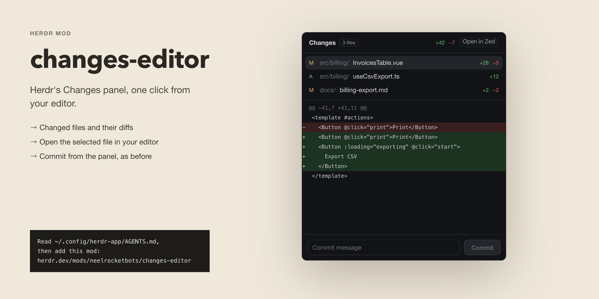

# Changes with editor

Herdr's Changes panel with one addition: when you select a changed file, an
"Open in <editor>" button in the header opens it in your own editor.
Everything else (the list of uncommitted changes, the diff view, the commit box)
works as in Herdr's panel.

## What you see

- A panel filling its block, on `background` with a 1px `border` and 10px
  corners.
- Header, 42px: "Changes" in semibold, a small pill with the file count, then
  the total `+12` in `ansi2` and `−3` in `ansi1`. With a file selected, "Open
  in Zed" (the editor's name) follows: 12px `muted` on `chrome`, 6px corners,
  `hover` with `foreground` text on hover.
- The changed files: 28px rows with the status letter (`A` in `ansi2`, `D` or
  `U` in `ansi1`, others in `blocked`), the folder in `dim` and the name, plus
  per-file `+n` / `−n`. The selected row is on `selected`.
- Below, the selected file's diff in the terminal font, scrolling both ways.
- At the bottom, a commit message input and a Commit button (`solid` when there's
  a message).

## How it behaves

- The panel follows the focused terminal's repo and refreshes as Herdr
  0.1.18's does: a folder watch plus a 10s poll, one `git status` shared with
  Files, longer waits after slow scans, none while the window isn't focused. It
  shows up to 1,000 changed files.
- Selecting a file shows its diff against `HEAD`.
- Commit runs `git add -A` and `git commit -m <message>` in the repo.
- "Open in <editor>" opens `<repo root>/<file>` in the editor set in
  `~/.config/herdr-app/herdr-mods.json` (`editor`). It tries the command, then
  the CLI, then `open -a <App>`, and shows an error toast if none works. It's
  hidden for deleted files (nothing to open) and for repos on another machine.
- The label comes from `shared("herdr-mods.editor")`, which quick-links writes.
  Without quick-links, the settings are read once at start.

## Built from

- A copy of Herdr's shipped `changes` mod (Apache-2.0), in a block
  `{ "mod": "changes-editor" }`. In the custom-herdr layout it's the `changes`
  child of the `panel-body` stack.
- Additions: the header button and `editor.js`.
- herdr: `spaces`, `panes`, `focused`, `exec`, `readTextFile`, `watchFolder`,
  `theme`, `settings`, `notify`, `checking`, `shared`; gpui-base `InputState`,
  `Input`, `Scrollbar`, `v_virtual_list` (as shipped).
- Programs: `git` (status, diff, add, commit, as shipped) and the editor's CLI
  or `open -a`.

## Watch out

- Herdr rewrites its shipped mods on every start: keep the change in a copy
  made with `mod.clone`, and point the layout's `changes` block at it. The copy
  won't get Herdr's later fixes to `changes`.
- Hide the button for status `D`: the file no longer exists.
- `editor.js` is a copy shared with quick-links, issue-worktree and files-md.
  Keep them identical.

## Done when

- Selecting a modified file shows "Open in <editor>", and clicking it opens
  that file in the editor.
- Selecting a deleted file shows no editor button.
- The diff and commit box work exactly as in Herdr's Changes panel.
