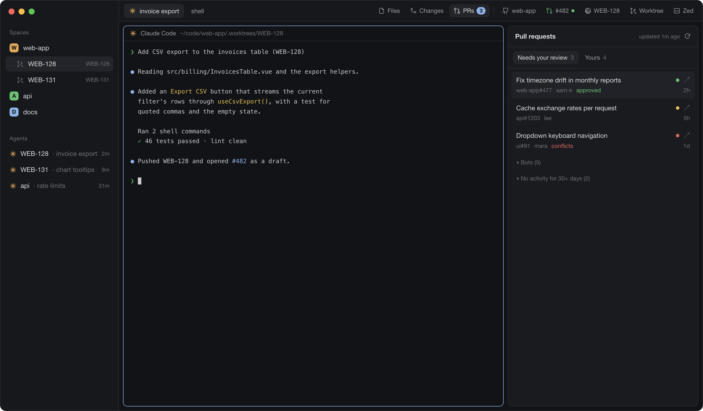

# custom-herdr

Herdr's main layout with the whole kit wired in: `quick-links` in the top bar,
`files-md`, `changes-editor` and `pr-inbox` as the side panels, and shortcuts for
the worktree dialog and the PR inbox.



## What's in it

- `layouts/custom-herdr.json`: Herdr's `main` layout with a `quick-links` block
  after the tabs, and the side panel stack (`panel-body`) holding `files`
  (`files-md`), `changes` (`changes-editor`) and `prs` (`pr-inbox`). The Files,
  Changes and PRs buttons toggle them.
- `layouts/custom-herdr.svg`: its picture in Settings.
- `mods/`: copies of all five mods, so the layout installs on its own.
- `keys.json`: **⌘⌥N** worktree dialog, **⌘⌥P** PR inbox.

## Install

```sh
sh install.sh custom-herdr --switch
```

Or ask your Herdr agent: *Read ~/.config/herdr-app/AGENTS.md, then add this
layout:* this folder. Switch back to Herdr's own with **ctrl-shift-l** or
Settings; deleting the files removes it.

## Settings

`~/.config/herdr-app/herdr-mods.json`: `editor` and `linear` (see the
[root README](../README.md#settings-configherdr-appherdr-modsjson)).

How it's built: [RECIPE.md](RECIPE.md). Part of [herdr-mods](../README.md).
