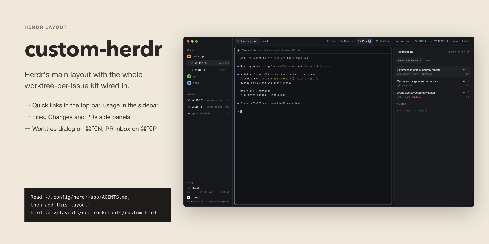

# custom-herdr

Herdr's main layout set up for one worktree per issue. The top bar adds quick
links for the focused terminal (PRs, GitHub repo, PR with CI, Linear issue,
Worktree, editor). The side panel holds three stacked views: Files with
markdown, Changes with an editor button, and the PR inbox. Spaces and agents
stay on the left as in Herdr's default window.

## What you see

- Left, a sidebar 268px wide (44 to 480): Herdr's brand row (46px), Spaces and
  Agents sharing the height equally (90px minimum each), the usage-limits
  block (sized to its rows), and its footer (69px).
- Right, from top to bottom:
  - A 42px top bar: Herdr's tab strip taking the width, then the quick-links
    block on the right. That block starts at 0px and quick-links sizes it to
    its buttons.
  - The work area: the active tab's panes with 10px corners, 8px gaps, a 1px
    `border` (`accent` on the focused pane) and a 30px pane header always
    shown. To their right, the side panel: 368px (280 to 900), hidden until a
    panel button opens it.
  - A 28px status bar.
- The side panel shows one of three views: `files` (files-md), `changes`
  (changes-editor) or `prs` (pr-inbox). Herdr's Files and Changes buttons and
  the quick-links PRs button switch between them.
- In Settings > Look the layout shows its own preview,
  `layouts/custom-herdr.svg`.

## How it behaves

- The Files, Changes and PRs buttons show the side panel on their view, or hide
  it when that view is already showing. Herdr's tab bar remembers the open view
  per space; pr-inbox adds `prs` to `shared("workspace.panels")` so it's
  remembered too.
- The quick-links block grows and shrinks with its buttons as you move between
  terminals.
- `cmd-alt-n` opens the Worktree dialog and `cmd-alt-p` the PR inbox as a
  dialog (keys.json).
- Settings for all the mods are in `~/.config/herdr-app/herdr-mods.json`:
  `editor` and `linear`.

## Built from

- Node tree, `root` row: `sidebar` column (`brand` block `workspace-chrome`;
  `sidebar-lists` column of `spaces` and `agents`; `sidebar-footer` block
  `workspace-chrome` with `{ footer: true }`), then the `work` column:
  - `topbar` row, 42px: `tabs` block (`tabs`, weight 1), then the
    `quick-links` block (`quick-links`, `{ block: "quick-links" }`, starting at
    px 0).
  - `work-body` row: `main` block (`{ tab: "active" }`, pane header mod `pane`,
    radius 10, gap 8), then the `panel` column (px 368, min 280, max 900,
    hidden) containing the `panel-body` stack (active `files`) with blocks
    `files` (files-md), `changes` (changes-editor) and `prs` (pr-inbox).
  - `status` block (`workspace-status`, 28px).
- Root: `titlebar: "none"`, `traffic_lights: [12, 16]`,
  `preview: "layouts/custom-herdr.svg"`.
- Mods: `quick-links`, `issue-worktree`, `pr-inbox`, `files-md`,
  `changes-editor` (in `mods/`), plus Herdr's shipped `workspace-chrome`,
  `spaces`, `agents`, `tabs`, `pane` and `workspace-status`.
- `keys.json`: `cmd-alt-n` → `mod.open:issue-worktree`, `cmd-alt-p` →
  `mod.open:pr-inbox`.

## Watch out

- The panel's child ids must stay `files`, `changes` and `prs`: Herdr's tab
  bar and quick-links select the stack children by these ids.
- Never set `hidden` on the quick-links block. A mod only starts once its block
  shows, and a hidden block is remembered across restarts. It sits at px 0 and
  sizes itself.
- Layout names allow only letters, digits, `-` and `_`.
- Herdr won't update a cloned layout when its own `main` changes.
- The mods in `mods/` are copies of the single-mod folders in this repo. Keep
  them identical.

## Done when

- Switching to the layout shows the sidebar, the top bar with quick links on
  the right, the panes, and the status bar.
- Files, Changes and PRs each open the side panel on their view and close it on
  a second click.
- `cmd-alt-n` opens the Worktree dialog for the focused terminal's repo.
- The preview in Settings shows the layout's picture instead of a blank frame.
