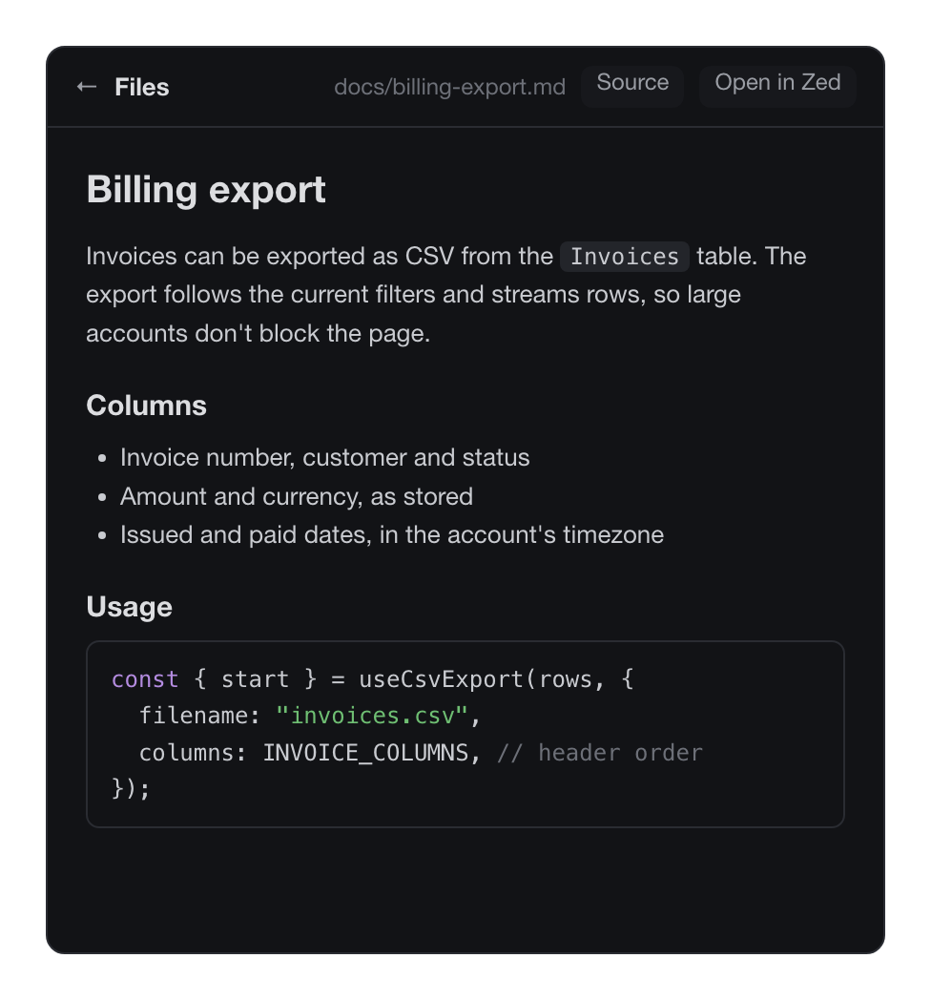

# files-md

Herdr's Files panel with two additions: markdown files render (headings, lists,
tables, code), and the shown file opens in your editor with one click.



## What it adds

- `.md`, `.markdown`, `.mdx` files open **rendered**, images included (local
  ones next to the file, and remote ones); **Source** shows the highlighted
  text, **Preview** switches back. A click on an image opens its link or the
  image.
- **Open in &lt;editor&gt;** in the header opens the shown file (local folders only).
- Everything else is Herdr's Files panel as shipped: the tree of the focused
  terminal's folder and syntax-highlighted previews.

It's a copy of Herdr's shipped `files` mod (Apache-2.0), because Herdr rewrites
its own mods on every start.

## Install

```sh
sh install.sh files-md
```

Or ask your Herdr agent to add this folder. Then point the layout's Files block at
it: `"content": { "mod": "files-md" }` on the `files` child of `panel-body`
(`custom-herdr` does).

## Settings

`editor` in `~/.config/herdr-app/herdr-mods.json`; the button shows its name.

## What it runs

Herdr's own file listing and reads, plus your editor's CLI or `open`. For
images in markdown: copies them (`cp`), or downloads remote ones (`curl`), into
`~/.config/herdr-app/data/files-md/img`, and reads their size with `sips`.

How it's built: [RECIPE.md](RECIPE.md). Part of [herdr-mods](../README.md).
