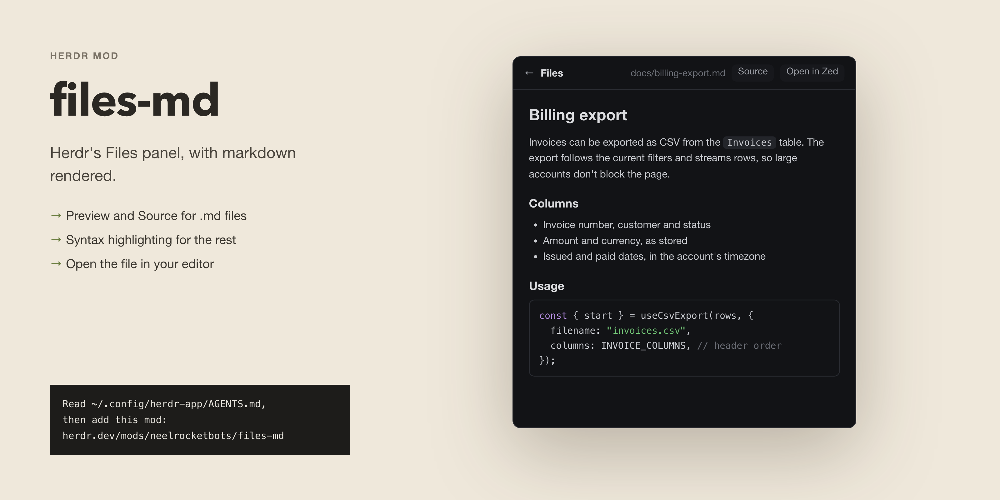

# Files with markdown

Herdr's Files panel with two additions. Markdown files open rendered, with a
Source toggle, instead of as raw text. Every file you open gets an "Open in
<editor>" button for your own editor. Everything else (the lazy tree of the
focused terminal's folder, git marks, read-only previews with syntax colors)
works as in Herdr's panel.

## What you see

- A panel filling its block, on `background` with a 1px `border` and 10px
  corners, 13px text.
- Header, 42px: "←" (when a file is open), "Files" in semibold, then the folder
  name or the open file's path, right-aligned in 12px `dim`. For a markdown
  file a "Source" / "Preview" button follows, then "Open in Zed" (the editor's
  name). Both buttons are 12px `muted` on `chrome` with 6px corners, and turn
  `hover` with `foreground` text on hover.
- The tree: 28px rows indented 18px per level, 12px chevrons, 14px folder and
  file icons, the name, and a git mark on the right: `A` in `ansi2`, `D` or `U`
  in `ansi1`, others in `blocked`.
- An open file: rendered markdown (headings, lists, inline code, code blocks,
  links), selectable, in a scrollable area with 18px by 14px padding. Source
  view and every other file show a read-only editor with syntax colors.

## How it behaves

- The tree follows the focused terminal's folder (its pane's folder, else the
  space's). It reads folders lazily, 500 entries per folder and 5,000 in all,
  and refreshes every 10s.
- Clicking a file reads it with `readTextFile` (on the space's machine). Binary
  files say so. Text over 400,000 characters is truncated with a note.
- Files ending in `.md`, `.markdown`, `.mdx`, `.mdown` or `.mkd` open rendered.
  The Source button switches to the editor view and back. The choice stays
  while you browse other files.
- "Open in <editor>" opens `<root>/<file>` in the editor set in
  `~/.config/herdr-app/herdr-mods.json` (`editor`: `zed`, `cursor`, `vscode`,
  `windsurf`, `sublime`, `webstorm`, `idea`, `nova`, or `{ name, app }` /
  `{ name, command: [..., "{path}"] }`). It tries the command, then the CLI,
  then `open -a <App>`, and shows an error toast if none works. The button only
  shows for files on this computer.
- The button's label is `shared("herdr-mods.editor")`, which quick-links writes.
  Without quick-links, the settings are read once at start.
- "←" goes back to the tree.

## Built from

- A copy of Herdr's shipped `files` mod (Apache-2.0), in a block
  `{ "mod": "files-md" }`. In the custom-herdr layout it's the `files` child of
  the `panel-body` stack.
- Additions: gpui-base `TextView.markdown(id, text).selectable(true)` for the
  preview, a `source` flag, and `editor.js` for the button.
- herdr: `spaces`, `panes`, `focused`, `exec`, `readTextFile`, `watchFolder`,
  `theme`, `settings`, `window`, `notify`, `checking`, `shared`.
- Programs: `sh` to list folders, `git` for marks (as shipped), and the
  editor's CLI or `open -a`.

## Watch out

- Herdr rewrites its shipped mods on every start, so changes must live in a
  copy. Clone with `mod.clone`, which rewrites the copy's own `mods/<name>/`
  asset paths, then point the layout's block at the copy. A copy won't get
  Herdr's later fixes to `files`.
- `markdown` starts as `undefined`, not `null`; test with `!= null` or the
  button shows before any file is open.
- `editor.js` is a copy shared with quick-links, issue-worktree and
  changes-editor (mods can't import across folders). Keep them identical.
- Don't poll the settings file for the label; read the shared name.

## Done when

- Opening a `.md` file shows it rendered, and Source shows the raw text with
  syntax colors.
- "Open in Zed" (or the configured editor) opens the file in that editor.
- Changing `editor` in `herdr-mods.json` relabels the button within seconds
  (with quick-links running).
- Code files still open in the read-only editor exactly as in Herdr's panel.
