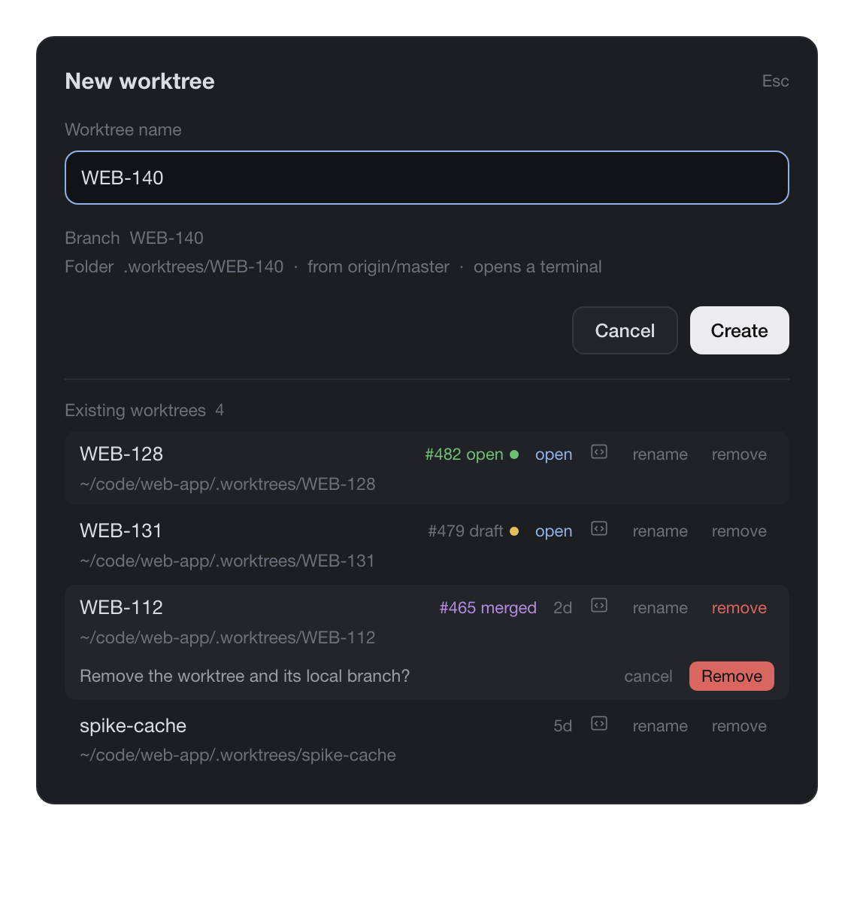

# issue-worktree

A dialog for working one git worktree per issue: name it after the Linear issue,
and it makes `<repo>/.worktrees/<name>` on a branch of that name, from a fresh
`origin/master`, and opens a space there. Below, every existing worktree with
its PR and CI, ready to open, rename or remove.



## What it does

- **Create**: type a name (`WEB-140`), Enter. Fetches `origin/master`, adds the
  worktree, opens a space with a terminal in it. A name that exists opens it instead.
- **List**: every worktree of the repo (not the main checkout), newest commit
  first, filtered as you type. Each row shows its branch, PR (`#482 open`, `draft`,
  `merged`) with a CI dot, `open` when a space shows it, else how long since its
  last commit.
- **Click a row**: go to its space, or open one there.
- **Editor icon**: open the worktree in your editor.
- **rename**: rename the branch; optionally move the folder to
  `.worktrees/<new name>` too (closes and reopens its space). Warns when the branch
  was pushed: the remote keeps the old name.
- **remove**: removes the worktree, its local branch and its space, after a
  confirm that warns about uncommitted changes.

All worktrees' PRs come from one GitHub request, remembered for a minute between opens.

## Install

```sh
sh install.sh issue-worktree
```

Or ask your Herdr agent to add this folder. Open it with **⌘⌥N** (from
`keys.json`), the Worktree button of `quick-links`, or `mod.open:issue-worktree`.

## Settings

`editor` in `~/.config/herdr-app/herdr-mods.json` picks the editor. The base
branch is `BASE` at the top of `main.js` (`origin/master`).

## What it runs

`git fetch`, `git worktree add/move/remove`, `git branch -m/-D`, `git status`;
`gh api graphql` (GitHub, with `gh`'s login); your editor. When the repo doesn't
already ignore `.worktrees/`, it appends that line to `.git/info/exclude`.

How it's built: [RECIPE.md](RECIPE.md). Part of [herdr-mods](../README.md).
