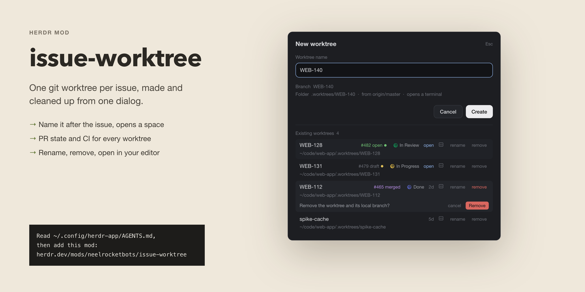

# Issue worktree

A side panel, or a dialog in layouts without a slot for it, for working one
git worktree per issue. You type a name (usually a
Linear ID such as `WEB-140`), and it creates `<repo>/.worktrees/WEB-140` on a
branch of the same name from a fresh `origin/master`, then opens a space there
with a terminal. Below the form it lists the repo's existing worktrees, each
with its pull request and CI, an open-in-editor button, rename and remove.

## What you see

- Panel: sized like the PRs panel. Fills the side panel on `background` with
  a 1px `border`, 10px corners and 13px text. A 42px header (14px sides,
  `border` below): "Worktrees" semibold, then the repo's folder name in 11px
  `dim`. Then a form block (14px sides, 10px top and bottom, `border` below):
  a 30px input (7px corners, `accent` border, 12px text) with a 30px "Create"
  button on `solid` beside it, the two hint lines, then busy/error lines, all
  11.5px. "Existing worktrees" (11.5px `dim`) and the list (6px padding) take
  the rest; rows have 10px sides, 7px top and bottom, 3px between lines. It
  follows the focused terminal's folder while shown (same repo: reload;
  another repo: start over), reloads when shown again after 60s, and focuses
  the name field on showing. Creating clears the field and reloads instead of
  closing. On start it adds `"worktrees"` to `shared("workspace.panels")`, so
  Herdr's tab bar remembers it per space like Files, Changes and PRs.
- Dialog: 460px wide on the theme's `popover`, with 18px padding. The title
  "New worktree" is 15px semibold, with "Esc" in 11px `dim` on the right.
- "Worktree name" (11.5px `dim`), then a 36px input with 9px corners, a 1px
  `accent` border on `background`, and 12.8px text. Placeholder:
  `WEB-140 (also filters the list below)`.
- Two 11.5px `dim` lines: `Branch  WEB-140` and `Folder  .worktrees/WEB-140 ·
  from origin/master · opens a terminal`. When that folder already exists:
  `.worktrees/WEB-140 already exists · Enter opens it`.
- Errors as 11.5px `ansi1` text. While working, a 11.5px `dim` status on the
  left of the buttons ("Fetching origin/master…", "Creating WEB-140…").
- Buttons 32px tall with 8px corners: Cancel (`raised`, `input` border) and
  Create (`solid`; it reads "Open" when the folder exists, "Working…" while
  busy, at 0.6 opacity).
- A 1px `border` line, then "Existing worktrees" with a count (`8`, or `3/8`
  when filtered).
- Rows of at least 44px with 7px corners; the row whose space is the one shown
  now sits on `selected`.
- Work on a row (checking before Remove, removing, renaming) shows on that
  row: it dims to 70%, ignores clicks, and its editor/rename/remove give way to
  a 12px ring spinner (`spinner.svg`, `.spin(900)`, `working`) with "Checking…",
  "Removing…" or "Renaming…" in 11px `muted`. Creating shows the same spinner
  with its step ("Fetching origin/master…", "Creating …") under the form. Line one: the folder (its path under
  `.worktrees/`, e.g. `HOT-3086` or `FRONT-504/web`, else the folder's name),
  a PR chip (`#482 open`, `#479 draft`, `#465 merged`; 11px, tinted `ansi2`,
  `ansi5`, `ansi1`, or `dim` for drafts) with a 6px CI dot on open PRs, then
  the Linear status chip (12px Linear icon in the status's color, then e.g. "In Review",
  11px `muted`; tooltip "<ID>: <title>", click opens the issue), then
  "open" in `accent` when a space shows it, else how long since its last commit
  (`5m`, `3h`, `2d`, `1mo`), then a 13px editor icon, "rename" and "remove"
  (11px `dim`; remove turns `ansi1` on hover). Line two, 11.5px `dim`: the
  branch (or "detached") and `  ·  ` unless the branch equals line one, then
  the path with `~` for home.
- The list is as tall as its rows (56px each, plus 120 for a row being renamed
  and 36 for one confirming removal), at most 320px, then it scrolls with a
  scrollbar.

## How it behaves

- It opens from the quick-links Worktree button with `{ cwd }`, or from
  `cmd-alt-n` (`mod.open:issue-worktree`) on the focused terminal's folder. The
  input has focus.
- The repo: `git rev-parse --git-common-dir` finds the main checkout even from
  inside another worktree. Worktrees come from `git worktree list --porcelain`,
  without the main checkout or prunable and bare entries, newest commit first
  (`git for-each-ref` committer dates).
- PRs: one `gh api graphql` request for every branch's latest PR (open, merged
  or closed) with its checks. It's kept per repo for 60s in module scope, so
  reopening shows them at once. The CI dot follows the same rules as
  quick-links (`ci.js`).
- Linear status: the branch's issue ID (`linear.js`, shared with quick-links),
  one request for all rows, cached 60s in module scope. No API key: no chip,
  asked again after 60s.
- Typing filters the rows by branch and path. Enter or Create: the name splits on
  `/`; every part must match `^[A-Za-z0-9][A-Za-z0-9._-]*$` and not end in
  `.lock`, and the name must not contain `..`. The whole name is the branch, the
  last part the folder (`hotfix/WEB-140` -> `.worktrees/WEB-140`); the two
  hint lines show both. An existing folder just opens. Otherwise it checks
  `git check-ref-format --branch`, runs `git fetch origin master`
  (2-minute limit), adds `.worktrees/` to `.git/info/exclude` when the repo
  doesn't ignore it, runs `git worktree add -b <branch> <dir> origin/master`,
  closes and runs `space.new { folder }`.
- Clicking a row goes to the space showing that folder (`space.select`), else
  runs `space.new` there. The space is the one whose first terminal is inside
  the folder; the deepest worktree wins. Clicking the PR chip opens the PR, or
  the failing run while CI fails. The editor icon opens the folder in the
  configured editor.
- Remove: `git status --porcelain` decides the prompt. Clean: "Remove the
  worktree and its local branch, and close its space?". Dirty (in `ansi1`):
  "Uncommitted changes will be lost. Remove anyway?". Confirming closes the
  space (`space.close` confirmed), runs `git worktree remove` (`--force` when
  dirty) and `git branch -D`. A failed branch delete becomes a warning toast.
  After a remove or move, `rmdir` walks up from the old folder's parent while
  it's inside `.worktrees/` (not `.worktrees/` itself), stopping at the first
  folder that isn't empty.
  Opening with `{ remove: <path> }` goes straight to that row's confirmation.
- Rename: an inline input prefilled with the branch, and a checkbox "Also move
  the folder to .worktrees/<last part of the name>" (with "closes and reopens
  its space" when one is open). It's checked by default for detached rows.
  A pushed branch (has an upstream) shows a `blocked` note that the remote and
  any open PR keep the old name. Renaming runs `git check-ref-format --branch`,
  `git branch -m`, and with the box checked `git worktree move`, closing the
  space before the move and opening a new one after.
- After a rename or remove, the list and PRs reload. Esc closes.

## Built from

- A layout block (`panel-body` child `worktrees`; panel mode is "no
  `props().overlay`", shown when the panel is visible with `active:
  "worktrees"`) or an overlay: `mod.json` overlay `{ kind: "dialog", width: 460 }`,
  `props` `cwd` and `remove`. `keys.json` binds `cmd-alt-n` (dialog). The panel
  takes a pending Remove from `shared("issue-worktree.remove")` (a worktree
  path), clearing it once that row is found.
- herdr: `exec`, `run` (`space.new`, `space.select`, `space.close`), `props`,
  `closeOverlay`, `focused`, `spaces`, `panes`, `home`, `notify`, `shared`
  (`herdr-mods.editor` for the tooltip), `theme`, `checking`; gpui-base
  `InputState`, `Input`, `Scrollbar`.
- Programs: `git`, `gh api graphql`, `test`, `sh` (to append the exclude line),
  `open`, and the editor's CLI or `open -a`.
- Files: `ci.js` and `editor.js` (copies shared with quick-links).

## Watch out

- A content-sized dialog gives a list no height, so `max_h` with
  `overflow_y_scrollbar` never scrolls. Use a `relative()` box with an explicit
  `h(...)`, an `absolute` `size_full` list with `overflow_y_scroll`, and a
  `Scrollbar.vertical` over it.
- Each open is a new copy of the mod with fresh instance state and
  localStorage. The PR cache lives in module scope, which copies share.
- Inner controls (PR chip, editor, rename, remove, the rename box) must stop
  click propagation, or the row's click opens the space.
- `InputState.new` needs a live host call: create both inputs in `init`, never
  in `render`.
- The editor icon is the mod's own `editor.svg` (`mods/issue-worktree/editor.svg`):
  loading it from another mod's folder leaves it blank when that mod isn't installed.
- `BASE` (`origin/master`) is a constant at the top of `main.js`.

- A process running inside the worktree (a dev server, an agent's shell) can make
  `git worktree remove` stop partway: git drops its record and the `.git` file but
  files stay, and every retry fails with "is not a working tree". The confirm lists
  such processes (`lsof -a -d cwd`); on failure the mod runs `git worktree prune`
  and, if git no longer lists the path and it's inside `<repo>/.worktrees/`,
  deletes the folder.

## Done when

- Typing `WEB-140` and pressing Enter creates `.worktrees/WEB-140` on branch
  `WEB-140` from `origin/master` and opens a space there with a terminal.
- Typing an existing name changes the button to "Open" and Enter goes to its
  space.
- Rows show their PR state and CI dot, and reopening within a minute shows
  them before any request finishes.
- Removing a worktree with changes warns in red, then removes the worktree,
  the branch and the space.
- With eight or more worktrees the list stops at 320px and scrolls.
