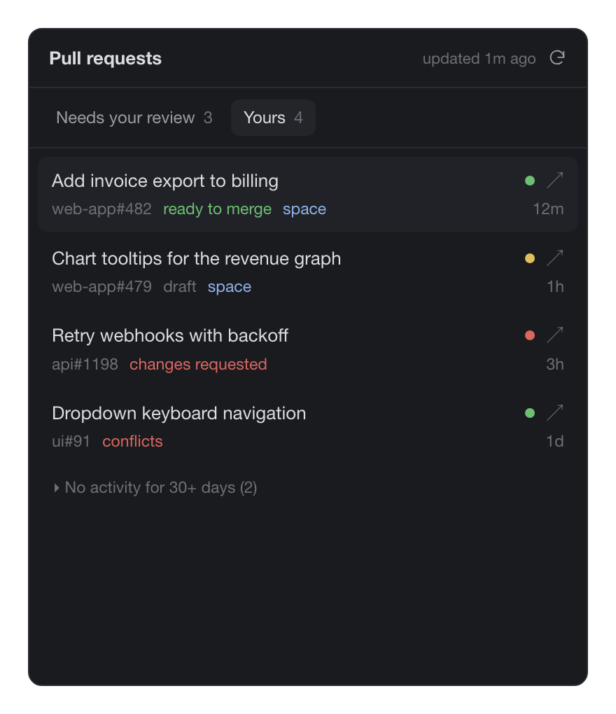

# pr-inbox

Your open pull requests across every repo, in one list: the ones waiting on your
review, and your own. A side panel next to Files and Changes, or a dialog in
layouts without that slot.



## What it does

- Two tabs: **Needs your review** and **Yours**, newest activity first.
- Each row: title, `repo#number`, author (review tab), `draft`, `approved`,
  `changes requested`, `conflicts` or `ready to merge`, a CI dot, `space` when
  you have a space on that branch, and its age.
- **Click**: go to your space for that branch, else open it on GitHub. **↗** always
  opens GitHub. **↻** refreshes.
- Bots (dependabot, github-actions, ...) and PRs idle for 30+ days fold into rows
  of their own.
- Refreshes every 3 minutes while shown, every 10 while hidden (for the count on
  `quick-links`' PRs button), and when you open it with data over a minute old.
  Nothing while the Herdr window is minimized, hidden or covered; it catches up
  when the window is back.
  The last result is kept on disk.

## Install

```sh
sh install.sh pr-inbox
```

Or ask your Herdr agent to add this folder. Open it with **⌘⌥P** (from
`keys.json`), `quick-links`' PRs button, or `mod.open:pr-inbox`. As a side panel,
add a child `{ "id": "prs", "type": "block", "content": { "mod": "pr-inbox" } }`
to the layout's `panel-body` stack (`custom-herdr` has it).

## What it runs

One `gh api graphql` search (GitHub, with `gh`'s login) per refresh; `open` for
links. No files outside its own.

How it's built: [RECIPE.md](RECIPE.md). Part of [herdr-mods](../README.md).
