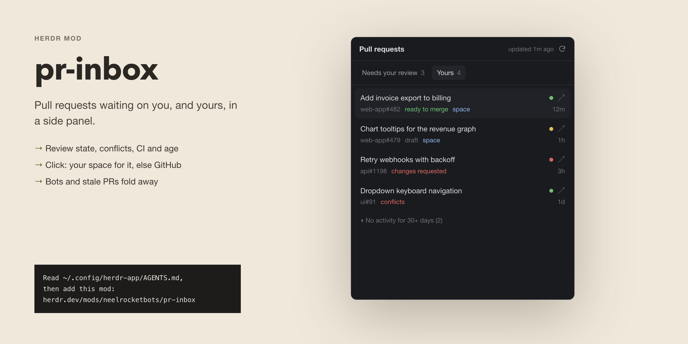

# PR inbox

Your open pull requests in one place, across every repo: the ones waiting on
your review, and your own. Each row shows its review state, conflicts, CI and
age. A click takes you to your worktree's space for that branch, or to GitHub.
It sits in the side panel next to Files and Changes, or opens as a dialog in
layouts without that slot.

## What you see

- A panel filling its block, on `background` with a 1px `border` and 10px
  corners, 13px text.
- Header, 42px: "Pull requests" in semibold, then on the right "updated 2m ago"
  (or "refreshing…") in 11px `dim`, and a ↻ button (`muted`, `hover`
  background).
- Tabs, 26px tall with 6px corners: "Needs your review" and "Yours", each with a
  count in 11px `dim`. The active tab is on `selected` in `foreground`, the
  other on `background` in `muted`. Counts leave out bots and PRs idle for 30+
  days.
- Rows with 10px by 7px padding, 7px corners and `hover` background. Line one:
  the title (truncated), a 7px CI dot (passing `ansi2`, failing or error
  `ansi1`, running or waiting `ansi3`), and ↗ in 11px `dim`. Line two in 11.5px
  `dim`: `web-app#482`, the author (review tab only, at most 110px), states
  (draft in `dim`, approved in `ansi2`, changes requested and conflicts in
  `ansi1`, "ready to merge" in `ansi2` for your own approved, mergeable,
  passing PRs), "space" in `accent` when you have a space on that branch, and
  the age on the right (`5m`, `3h`, `2d`, `1mo`).
- At the bottom of each tab, folded rows: "▸ Bots (5)" (review tab: authors
  ending in `[bot]` or named github-actions, dependabot, renovate, crowdin,
  snyk-bot) and "▸ No activity for 30+ days (2)". Clicking one shows them.
- Errors as 12px `ansi1` under the tabs. Empty tabs: "Nothing waiting on your
  review" or "No open pull requests".
- The list scrolls with a scrollbar.

## How it behaves

- Data comes from one `gh api graphql` request: two searches,
  `is:pr is:open archived:false review-requested:@me` and
  `... author:@me`, 50 each, with title, URL, draft, updated time, head branch,
  review decision, mergeability, repo, author and the last commit's CI state.
  Both are sorted newest first.
- Refresh: every 3 minutes while it's on screen, every 10 minutes while hidden
  (checked every 30s), on opening it when the data is over a minute old, and on
  ↻. Not while `window()?.visible` is false (minimized, hidden, covered):
  `render` checks again once the window is back. It's on screen when it's a dialog, or the layout's `panel` is shown with
  `panel-body` on `prs`.
- The last result is saved in localStorage (`pr-inbox.cache.v1`) and shown at
  once on start.
- After each refresh the count of non-bot, non-stale review requests is written
  to `shared("prinbox.review")`, only when it changed. The quick-links PRs
  button shows it.
- Clicking a row: a local space whose branch equals the PR's head branch is
  selected (`space.select`); otherwise the PR opens in the browser. ↗ always
  opens the browser.
- On first start it adds `"prs"` to `shared("workspace.panels")`, so Herdr's tab
  bar keeps this panel per space like Files and Changes.

## Built from

- In a layout: a block `{ "mod": "pr-inbox" }` with id `prs` in the
  `panel-body` stack. Otherwise `mod.json` overlay `{ kind: "dialog", width:
  480, height: 0.8 }`, opened by `mod.open:pr-inbox` (`keys.json` binds
  `cmd-alt-p`) or the quick-links PRs button.
- herdr: `exec`, `run` (`space.select`), `spaces`, `shared`, `setShared`,
  `layout`, `props`, `theme`, `checking`; gpui-base `Scrollbar`.
- Programs: `gh` (signed in) and `open`.

## Watch out

- `setShared` re-renders every mod, so write the count only when it changes.
- A copy keeps running while its block is hidden, timers included. Refresh
  slowly when hidden instead of stopping, or the top bar's count goes stale.
- The list needs a definite height to scroll: a `flex_1` `relative` box with an
  `absolute inset_0` list and a `Scrollbar.vertical` over it.
- A mod copy starts only when its block first shows, so the count appears after
  the panel has been opened once.
- The review queue is mostly bots in busy repos. Fold them, don't drop them.

## Done when

- Opening the panel lists the PRs requesting your review with author, state,
  CI dot and age, and "Yours" lists your own.
- A row for a branch you have a space on says "space", and clicking it selects
  that space.
- Bot PRs and PRs idle for 30+ days sit behind folded rows with counts.
- After a restart the list shows before `gh` returns, then updates.
- The quick-links PRs button shows the same review count.
