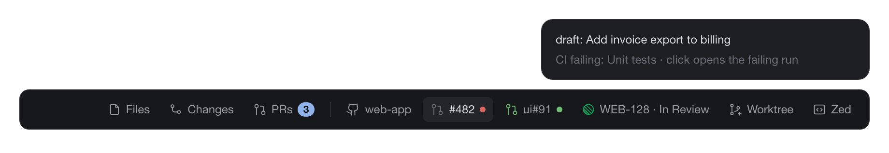

# quick-links

The focused terminal's GitHub, PR, CI and Linear links, as buttons on the right
of Herdr's top bar, plus a button that opens the folder in your editor.



## What it shows

| Button | When | Click |
| --- | --- | --- |
| **PRs** `3` | `pr-inbox` is installed | opens the PR inbox; the count is PRs waiting on your review |
| repo | the folder has a GitHub `origin` | opens the repo |
| `#482` + CI dot | the branch has a PR | opens the PR; while CI fails, the failing run |
| `ui#91` | no PR here, but an open PR in another repo of the org names the branch's Linear issue | opens that PR |
| `WEB-128` | the branch names a Linear issue and the owner is mapped in settings | opens the issue |
| `WEB-128 · In Review`, logo in the status color | the same, with a Linear API key in the Keychain | opens the issue |
| **Merged · clean up** | the PR merged and you're in a worktree (needs `issue-worktree`) | opens the worktrees panel (or dialog) on its Remove |
| **Worktree** | in a GitHub repo (needs `issue-worktree`) | toggles the worktrees panel (dialog in layouts without one) |
| editor | always, for local folders | opens the folder in your editor |

CI dot: green passing, yellow running, red failing. The tooltip lists the failing
checks. Lookups are cached on disk, so the buttons show at once after a restart.

## Install

```sh
sh install.sh quick-links
```

Or ask your Herdr agent: *Read ~/.config/herdr-app/AGENTS.md, then add this mod:*
this folder. Then put it in the top bar row, after the tabs (it sizes itself):

```json
{ "id": "quick-links", "type": "block", "size": { "px": 0 }, "window_drag": true,
  "content": { "mod": "quick-links", "props": { "block": "quick-links" } } }
```

The `custom-herdr` layout already has it.

## Settings

In `~/.config/herdr-app/herdr-mods.json` (see the [root README](../README.md#settings-configherdr-appherdr-modsjson)):
`editor` picks the editor button's app, `linear` maps GitHub owners to Linear
workspaces. Without a mapping there are no Linear links. A Linear API key adds
the issue's status ([setup](../README.md#linear-issue-status-optional)).

## What it runs

`git` (remote, branch, rev-parse) in the focused folder; `gh pr view` and
`gh search prs` (GitHub, with `gh`'s own login); your editor's CLI or `open`.
With a Linear key: `security` reads it from the Keychain, `curl` asks Linear's API.
Reads `herdr-mods.json` and other mods' `mod.json`.

How it's built: [RECIPE.md](RECIPE.md). Part of [herdr-mods](../README.md).
