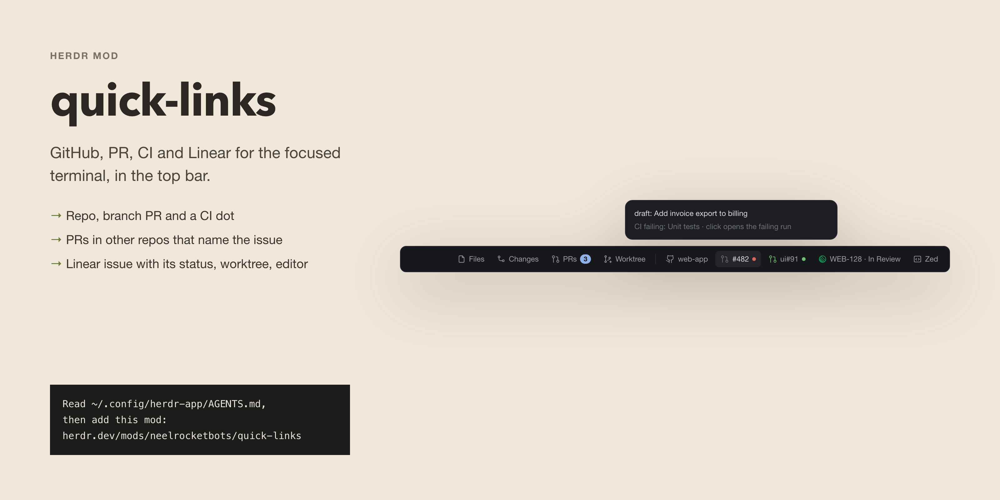

# Quick links

A row of small buttons on the right of the top bar, about the terminal you're
in. It shows the GitHub repo, the branch's pull request with a CI dot, the
branch's Linear issue, and buttons that open the folder in your editor, start a
worktree, and open the PR inbox. Everything comes from the focused terminal's
folder, git remote and branch, and changes as you move between terminals.

## What you see

- One row, right-aligned in its block, on the theme's `chrome` with a 1px
  `border` line along the bottom. Buttons are 26px tall, 8px side padding, 6px
  corners and 3px apart. Each has a 14px icon and a 12px `muted` label of at
  most 160px, truncated. Hovering turns the background `hover` and the label
  `foreground`.
- **PRs**: the `pr` icon and "PRs". It shows when the layout has a `prs` child
  in its `panel-body` stack, or when the pr-inbox mod is installed. Its
  background is `selected` while that panel is showing, otherwise `chrome`.
  When PRs wait on your review it carries a count pill: 10.5px text, `accent`
  background, `background` text, 8px corners.
- **Worktree** (in a GitHub repo, with issue-worktree installed): the worktree
  icon and "Worktree", beside PRs.
- A 1px by 16px `border` divider (only when there are links after it), then the links:
  1. **Repo**: the GitHub icon and the repo name, e.g. `web-app`.
  2. **PR**: the PR icon tinted by state (open `ansi2`, merged `ansi5`, closed
     `ansi1`, draft `dim`), the label `#482`, then for open PRs a 6px CI dot
     (failing `ansi1`, running `ansi3`, passing `ansi2`).
  3. If the branch has no PR in this repo but names a Linear issue, up to two
     open PRs from the owner's other repos that mention it, labelled with the
     repo name, e.g. `ui#91`.
  4. **Merged · clean up** in `ansi5`, on a worktree whose PR is merged.
  5. **Linear**: the Linear icon and the issue ID, e.g. `WEB-140`. With a Linear
     API key: `WEB-140 · In Review` with the Linear icon in the status's Linear color,
     tooltip "In Review: <title>"; an issue moved to another team shows its new
     ID ("(was WEB-140)").
  6. **Editor**, last: a code icon and the editor's name, e.g. "Zed".
- Tooltips: the PR's state and title plus the CI result and the names of the
  failing checks; "owner/repo" on the repo; "Open <folder> in <editor>".

## How it behaves

- A 300ms timer compares the focused terminal's machine, folder and branch with
  the last ones. It works only when they change, or every 20s otherwise.
  Focus on an overlay keeps what's shown.
- The repo comes from `git remote get-url origin` (GitHub URLs only). The branch
  comes from the pane, else `git branch --show-current`. There's no PR lookup
  on `main`, `master`, `dev`, `develop`, `staging` or `production`.
- The PR comes from `gh pr view <branch>`. Results stay fresh for 30s while CI
  runs, 60s while the PR is open, 10 minutes once merged or closed, and 2
  minutes when there's no PR.
- CI keeps the latest run of each check name (reruns repeat a name). Any failure
  means failing, else anything unfinished means running, else passing. Clicking
  the PR while failing opens the failing run, preferring a GitHub Actions run;
  otherwise it opens the PR.
- Linear ID: a `<TEAM>-<number>` between `/`, `_`, `.` or `-` anywhere in the
  branch. One written in uppercase wins, else the first. Words such as `node`,
  `vue`, `step` and `sprint` never count as a team. The Linear button and the
  cross-repo search only appear for owners mapped in settings. The search is
  `gh search prs <ID> --owner <owner> --state open --limit 10`. It keeps PRs
  whose title or body really contains the ID, newest first, and takes two at
  most, each with its own `gh pr view --json statusCheckRollup`. Those results
  stay fresh for 5 minutes.
- Clean up: once a PR shows as merged, `git rev-parse --show-toplevel --git-dir
  --git-common-dir` decides whether the folder is a linked worktree. If it is,
  the chip opens the issue-worktree dialog with `{ cwd, remove: <top> }`, which
  goes straight to that row's Remove.
- Worktree opens the issue-worktree dialog (`openOverlay`, a dialog 460px wide)
  with `{ cwd }`. Worktree and clean up only appear when
  `mods/issue-worktree/mod.json` exists. They are local only: nothing for
  spaces on other machines.
- PRs: in a layout with the `prs` slot it toggles the panel (`layout.select` on
  `panel-body`, then `layout.show`/`layout.hide` on `panel`). Otherwise it runs
  `mod.open` on `pr-inbox`. The count is `shared("prinbox.review")`.
- The editor button opens the terminal's folder in the configured editor.
- Settings come from `~/.config/herdr-app/herdr-mods.json`, re-read every 5s.
  `linear` maps a GitHub owner to its Linear workspace slug, with `"*"` for any
  owner. `editor` names the editor. Linear status comes from `linear.js` (shared
  with issue-worktree): a shell reads the API key (Keychain service
  `herdr-mods-linear`, else `$LINEAR_API_KEY`) and pipes it to `curl -H @-`;
  one GraphQL request with an aliased `issue(id:)` per ID (moved issues answer
  to old IDs). A missing ID nulls Linear's whole answer, so IDs named in the
  errors are marked not found and the rest asked again. Status is cached 2 min;
  with no key (or a refused one), Linear is asked again after 5 min. The editor's name is published once per
  change as `shared("herdr-mods.editor")`. Invalid JSON gives one error toast
  until it's fixed.
- The block resizes itself to its content plus 10px (`layout.resize`).

## Built from

- A layout block with `{ "mod": "quick-links" }`. `props.block` names the block
  to resize; the default is `quick-links`.
- herdr: `focused`, `panes`, `spaces`, `exec`, `run` (`layout.resize`,
  `layout.select`, `layout.show`, `layout.hide`, `mod.open`), `openOverlay`,
  `layout`, `shared`, `setShared`, `readTextFile`, `appHome`, `notify`,
  `theme`, `window`, `checking`, `props`.
- Programs: `git`, `gh` (signed in), `open` (macOS), `xdg-open` (Linux) or
  `cmd /c start` (Windows) for links, and the editor's CLI or `open -a`.
- Files: `ci.js` (CI summary), `editor.js` (settings plus opening in the
  editor), and the icons `github`, `pr`, `linear`, `worktree` and `editor`,
  as `.svg` strokes tinted with the text color.
- Cache: `localStorage` key `quick-links.cache.v1` holds the repo, PR,
  cross-repo PR and worktree lookups. It's written at most every 15s, only when
  something changed, and keeps 7 days or 200 entries per map, newest first.

## Watch out

- Never hide the block: a mod only starts once its block shows, and a hidden
  block is remembered across restarts. Resize it to 0 instead.
- `setShared` re-renders every mod, so write the editor name only when it
  changes.
- Mods can't import from another mod's folder, so `editor.js` (also in
  issue-worktree, files-md and changes-editor) and `ci.js` (also in
  issue-worktree) are copied and must stay identical.
- GitHub's PR search is fuzzy: `WEB-14` matches `WEB-140`. Check the ID again
  with a word boundary.
- Show cached links first and refresh behind them. Use a generation counter so
  a slow lookup for a terminal you've left doesn't overwrite the current one.
- `gh pr view <branch>` exits non-zero when there's no PR. Treat that as "no
  PR", not as an error.

## Done when

- In a repo on a branch with an open PR, the bar shows the repo, `#<n>` in
  green with a CI dot, and the Linear ID when the owner is mapped.
- Clicking the PR while its CI fails opens the failing Actions run.
- On a branch with no PR here, an open PR in another repo whose body says
  `WEB-140` shows as `<repo>#<n>`.
- On a worktree whose PR is merged, "Merged · clean up" opens the dialog on
  that worktree's Remove.
- Changing `editor` in `herdr-mods.json` relabels the editor button within 5s.
- After a restart, the links show before any `gh` call returns.
