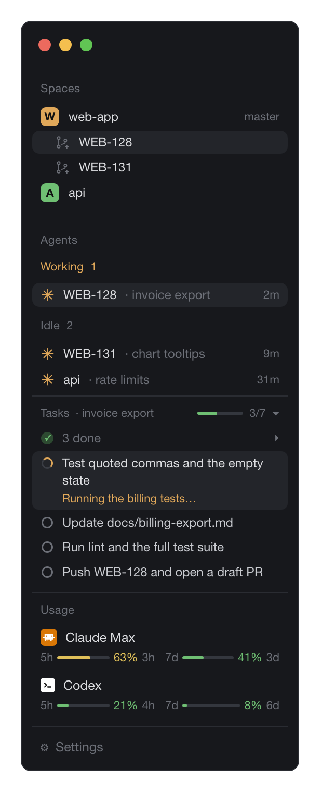

# spaces-compact

Herdr's Spaces list in the sidebar, a little smaller so more spaces fit: rows
26px instead of 30 (25 instead of 28 in tree view), row text 12px instead of 13, section headers 24px
instead of 26. Everything else works exactly as Herdr's own list.



## Install

```sh
sh install.sh spaces-compact
```

Then point your layout's spaces block at it: `"content": { "mod": "spaces-compact" }`
instead of `"mod": "spaces"` (`custom-herdr` does). It pairs with
[`agents-compact`](../agents-compact).

## What it runs

Nothing beyond Herdr's own `spaces` mod: it's a copy of it.

## Herdr updates

It's a copy of Herdr 0.1.18's `spaces` mod (`mod.json` `cloned_from`). After a
Herdr update, re-make it from the new `mods/spaces` with the same size changes
([RECIPE.md](RECIPE.md)) so it keeps Herdr's fixes.

How it's built: [RECIPE.md](RECIPE.md). Part of [herdr-mods](../README.md).
