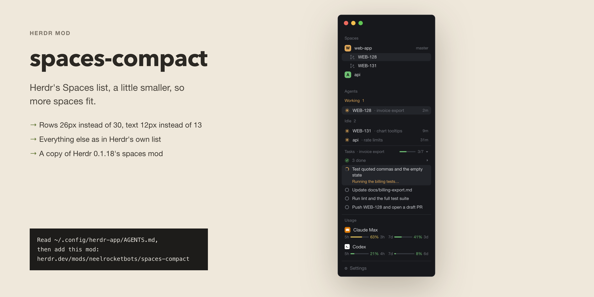

# Spaces, compact

Herdr's `spaces` sidebar list with slightly smaller rows and text, so more fit.

## What you see

Exactly Herdr's `spaces` mod, with these sizes:

| | Herdr | compact |
| --- | --- | --- |
| Row text (the list's base size) | 13px | 12px |

| Rows | 30px | 26px |
| Tree rows, loading and empty rows | 28px | 25px |
| Section headers (machines, groups) | 26px | 24px |

Smaller text (10 to 11.5px), icons, avatars and the panel header are unchanged.

## How it's made

Copy `~/.config/herdr-app/mods/spaces/` (`main.js`, `mod.json`) to
`mods/spaces-compact/`, then in `main.js`, in one pass (so no value is changed
twice): `.h(30)` → `.h(26)`, `.h(28)` → `.h(25)`, `.h(26)` → `.h(24)`,
`text_size(13)` → `text_size(12)`, `text_size(12.5)` → `text_size(11.5)`.
Also `rowHeight = ({ tree }) => (tree ? 28 : 30)` → `(tree ? 25 : 26)`.
`mod.json`: `{ "place": "none", "title": "Spaces", "cloned_from": { "name": "spaces", "version": "<Herdr version>" } }`.
A header comment says what changed. Redo it after each Herdr update.
