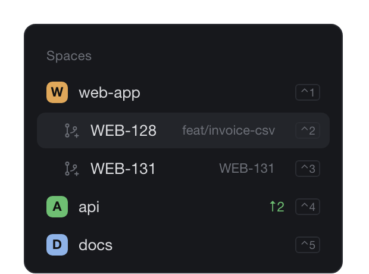

# spaces-keys

Herdr's Spaces list, with the key that selects each space on its row: `⌃1` on
the first, `⌃2` on the second, up to `⌃9`.



## What it does

- Everything Herdr's Spaces list does: avatars, worktrees under their checkout,
  branch and ahead/behind, machines, drag to reorder, right-click menu.
- Plus a small key label at the end of each row: the key bound to
  `space.select:<its position>` in your `keys.json` (Herdr binds `ctrl-1` to
  `ctrl-9`). Rebind them and the labels follow; a space without a key has none.

## Install

```sh
sh install.sh spaces-keys
```

Then point your layout's spaces block at it: `"content": { "mod": "spaces-keys" }`
(`custom-herdr` already does).

## Updating

It's a copy of Herdr's `spaces` mod (`cloned_from` in `mod.json`), so it doesn't
change when Herdr updates its own. To take a newer Herdr version, clone it again
(`herdr-app do mod.clone '{"name":"spaces","as":"spaces-keys"}'` after removing
this one) and re-apply the change in [RECIPE.md](RECIPE.md).

## What it runs

The same as Herdr's `spaces` mod (`git` for branch and ahead/behind, `hc`).
Reads `keys.json` through Herdr.

How it's built: [RECIPE.md](RECIPE.md). Part of [herdr-mods](../README.md).
