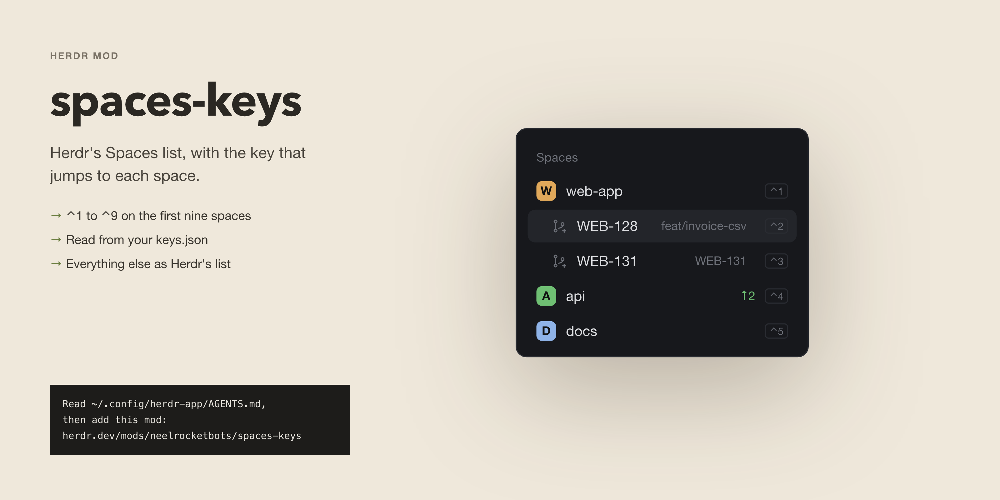

# Spaces with keys

Herdr's Spaces list with the key that selects each space shown on its row.

## What you see

- Herdr's Spaces list, unchanged, plus a key label at the right end of each
  full-width row, after the branch and ahead/behind: 14px tall, 3px side
  padding, 3px corners, a 1px `border` outline, 9.5px `dim` text, e.g. `⌃1`.
- The collapsed rail is unchanged (it already shows each space's number).

## How it behaves

- The label is the global binding for `space.select:<n>`, where n is the row's
  position in `spaces()` (1-based; the list keeps that order in step with what
  it shows). No binding: no label.
- Keys come from `keys()` once per render: the first global binding per action
  wins. Formatted like Herdr's own hints: `cmd` ⌘, `ctrl` ⌃, `alt`/`option` ⌥,
  `shift` ⇧ on macOS (Ctrl+, Alt+, Shift+ elsewhere), the key upper-cased.

## Built from

- `herdr-app do mod.clone '{"name":"spaces","as":"spaces-keys"}'`, then in
  `main.js`: import `keys`; add `keyLabel`, `keyMap` and `kbd` helpers after the
  imports; set `this.keys = keyMap()` at the start of `render()`; in `row()`,
  after the git tail, add `kbd(keyLabel(this.keys, "space.select:" + (i + 1)))`
  when there is one.
- The layout's spaces block: `{ "mod": "spaces-keys" }`.

## Watch out

- Herdr replaces its shipped mods at start; edit only the clone.
- A sidebar mod never has keyboard focus, so it can't show labels only while a
  modifier is held: they're always shown, small.

## Done when

- Each of the first nine spaces shows its `space.select` key, and changing
  `keys.json` changes the labels.
