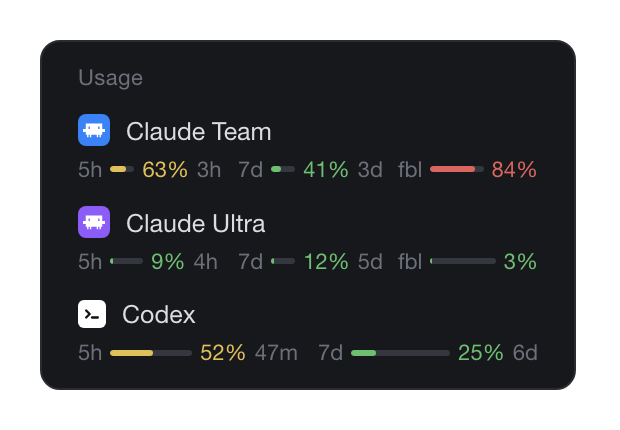

# usage-limits

Your Claude and Codex rate limits at the bottom of the sidebar, like a status
line: a row per account with every limit as a gauge, its % and when it resets.
It works on its own, with nothing from your status line.



## What it does

- **A row per account**: one per Claude Code config folder with a login, named
  by its current plan ("Claude Team", "Claude Ultra"), its icon a white Claude
  glyph on a tile in the plan's color (Ultra violet, Team blue, Max amber,
  Enterprise teal, Pro Claude orange), and Codex. Two folders on the
  same plan: the second shows its folder too ("Claude Max · 2").
- **Gauges across the row**: `5h`, `7d`, and a model's own weekly limit (`fbl`
  for Fable), each with a bar, the % (green, yellow from 50%, red from 80%) and
  the time to reset (`47m`, `3h`, `5d`). The tooltip has the full names and
  times, and how old the numbers are.
- **Collapse**: the chevron by "Usage" folds it to just the bars, one line per
  account. It remembers which.
- Both are checked every 5 minutes (Codex's numbers change only while Codex
  works), and not while the Herdr window is minimized, hidden or covered: they
  catch up when it's back. The last numbers are kept on disk, so rows show at once after a restart.

## Install

```sh
sh install.sh usage-limits
```

Or ask your Herdr agent to add this folder. Then add a block to your layout's
sidebar column, above its footer (`custom-herdr` has it):

```json
{ "id": "usage", "type": "block", "size": { "px": 62 },
  "content": { "mod": "usage-limits", "props": { "block": "usage" } } }
```

It sizes the block to its rows.

## What it runs

**Claude**: for each `~/.claude*` folder, `security` reads that folder's Claude
Code login from the macOS Keychain (`Claude Code-credentials`, plus a suffix
for folders other than `~/.claude`), and a shell pipes its access token to
`curl`, which asks Anthropic's usage endpoint (`api.anthropic.com/api/oauth/usage`).
Once an hour the same shell also asks Anthropic's profile endpoint
(`/api/oauth/profile`) for the account's plan, and passes on only the plan name.
The token is never stored, and never reaches the mod or a command line. The
endpoint is undocumented, so it may change. macOS may ask once to allow
`security` to read Claude Code's Keychain item. An expired token (Claude Code
renews it while it runs) skips the request.

**Codex**: `find`, `ls`, `grep` and `stat` on `~/.codex/sessions` for the newest
`rate_limits` Codex wrote. No network.

How it's built: [RECIPE.md](RECIPE.md). Part of [herdr-mods](../README.md).
