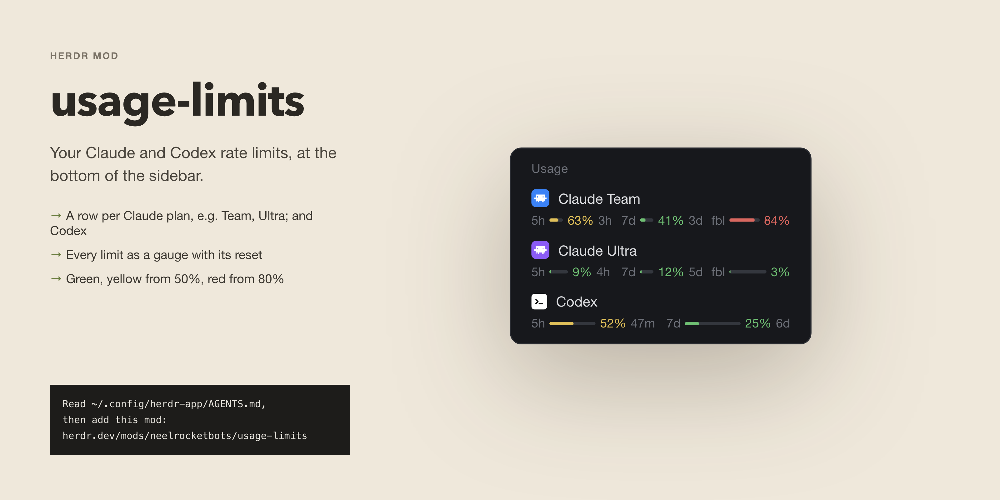

# Usage limits

Claude and Codex rate limits in a sidebar block, a row per account, every limit
shown as a small gauge with its reset time, like a Claude Code status line.

## What you see

- A block on `chrome` with a 1px `border` line on top, 10px side padding.
  "Usage" in 11px `dim` with a chevron on the right (▾ expanded, ▸ collapsed;
  `foreground` on hover). Clicking that line toggles; the state is kept in
  localStorage (`usage-limits.collapsed`).
- Collapsed: a 20px line per account, its icon then its bars only (no names,
  % or countdowns), same widths and colors, same tooltip.
- A row per account, 4px by 8px padding, 7px corners, `hover` background:
  - Line one: a 16px icon and the name in 12.5px `foreground`. Claude rows: a
    tile with 4px corners in the plan's color (`ultra` #8b5cf6, `team`
    #3b82f6, `max` #d97706, `enterprise` #0d9488, else Claude's #d97757)
    holding the program table's Claude icon at 11px, drawn white with `svg()`.
    Codex: its own icon (14px) from Herdr's program table. Claude rows are named by the account's current
    plan from Anthropic's profile endpoint: `organization.plan_display_name`
    ("Ultra": "Claude Ultra"), else `organization.organization_type` without
    `claude_` ("claude_team": "Claude Team"); none yet: "Claude". (The
    Keychain's `subscriptionType` is only as new as the last login, so it's not
    used.) Two rows with the same name:
    the later folder's gets " · <folder suffix>" ("Claude Max · 2"). Then "Codex".
  - Line two, full width: a gauge per limit, sharing the width equally, 10px
    apart, 11px text: the short name in `dim` (`5h`, `7d`, a model's weekly
    limit as 3 letters: `fbl` for Fable, `ops` for Opus), a 3px bar on `input`
    filled to the % (taking the gauge's spare width), the % and the countdown
    in `dim` (`47m` under 90 minutes, `3h` under 2 days, else `5d`).
  - Colors by %: `ansi2` under 50, `ansi3` from 50, `ansi1` from 80.
  - A model's weekly limit hides its countdown when it resets with `7d`.
  - Tooltip: the account and folder, "as of 3m ago", then each limit in full
    ("7-day Fable: 2%, resets in 5d 4h").
- Claude accounts first (by name), then Codex. No data at all: "No usage yet:
  sign in to Claude Code or Codex".

## How it behaves

- Claude and Codex, every 5 minutes, skipped while `window()?.visible` is
  false; `render` polls once the window is back. Claude: `sh` lists `~/.claude` and `~/.claude?*` folders.
  For each, a shell finds the Keychain item `Claude Code-credentials` (plus
  `-<first 8 hex of sha256(folder path)>` for any folder but `~/.claude`), pulls
  `claudeAiOauth.accessToken` and `expiresAt` with `plutil`, skips an expired
  token; once an hour per account it asks `GET /api/oauth/profile` and prints
  only the plan (the profile holds the email and name); then and pipes `Authorization: Bearer <token>` to `curl -H @-` with
  `anthropic-beta: oauth-2025-04-20` for `GET /api/oauth/usage`. The mod gets
  only the JSON and the HTTP status. `limits[]` maps: `session` to 5h,
  `weekly_all` to 7d, `weekly_scoped` to its `scope.model.display_name`. A 429
  waits 15 minutes; other failures keep the last answer.
- Codex: the 5 newest `.jsonl` files from the last 8 days in
  `~/.codex/sessions`, the last line with `"rate_limits":{` in the newest that
  has one, parsed only when that file changed. `primary` / `secondary` windows
  map by `window_minutes` (300 to 5h, 10080 to 7d).
- A limit past its reset time shows 0%. Countdowns re-render every minute.
- Rows are kept in localStorage (`usage-limits.v2`) and shown at start.
- The block resizes to its content height (`layout.resize` on `props.block`,
  default `usage`).

## Built from

- A layout block in the sidebar column: `{ "mod": "usage-limits", "props":
  { "block": "usage" } }`, `size.px` 62 to start.
- herdr: `exec`, `home`, `theme`, `run` (`layout.resize`), `props`,
  `checking`, `knownAgents` (icons); gpui-kit `svg`, `image`.
- Programs: `sh`, `security`, `plutil`, `shasum`, `curl`, `find`, `grep`, `stat`.

## Watch out

- Never let a token leave the shell: no argv (`curl -H @-` from stdin), no file,
  no return value.
- Claude Code names a non-default config folder's Keychain item with a hash of
  the folder's path; `~/.claude` has no suffix.
- The usage endpoint is undocumented and rate-limited: ask rarely and back off.

## Done when

- Each signed-in Claude config folder and Codex has a row whose numbers match
  that account's status line.
- Nothing is written outside the mod's own storage, and no token shows in `ps`.
